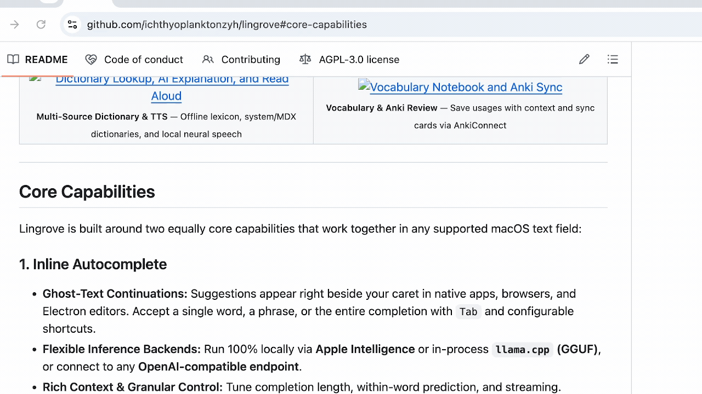

<div align="center">


# Lingrove · 拾语

**Local-first inline autocomplete and language learning while you write on macOS.**  
Get ghost-text continuations beside your cursor, translate sentences in place, find expressions from a description, look up words across reading and writing, and build your personal vocabulary corpus with built-in FSRS review or Anki sync—without leaving your editor.

[**English**](README.md) · [**简体中文**](README.zh-CN.md) · [**Releases**](https://github.com/ichthyoplanktonzyh/lingrove/releases) · [**FAQ**](FAQ.md) · [**Learning Docs**](docs/LANGUAGE_LEARNING.md) · [**Feedback**](https://github.com/ichthyoplanktonzyh/lingrove/issues)

[](#install)
[](#install)
[](#engines--models)
[](LICENSE)

</div>

> [!NOTE]
> **Development preview:** Lingrove is under active development. Check the [releases page](https://github.com/ichthyoplanktonzyh/lingrove/releases) for available downloads, or build from source.

---

## Preview

See the features in use below. The five Lingrove language-learning recordings use the Chinese interface.

<table align="center">
  <tr>
    <td width="50%" align="center" valign="top">
      <a href="gifs/imessage.gif"></a>
      <br />
      <sub><b>Autocomplete</b> — Ghost text at the caret; press Tab to accept.</sub>
    </td>
    <td width="50%" align="center" valign="top">
      <a href=".github/assets/readme/writing-translation.gif"></a>
      <br />
      <sub><b>Writing translation</b> — Pause after typing to preview a translation.</sub>
    </td>
  </tr>
  <tr>
    <td width="50%" align="center" valign="top">
      <a href=".github/assets/readme/expression-assistance.gif"></a>
      <br />
      <sub><b>Expression assistance</b> — Describe what you mean, then insert a candidate.</sub>
    </td>
    <td width="50%" align="center" valign="top">
      <a href=".github/assets/readme/double-click-lookup.gif"></a>
      <br />
      <sub><b>Double-click lookup</b> — Double-click to compare contextual and dictionary meanings.</sub>
    </td>
  </tr>
  <tr>
    <td width="50%" align="center" valign="top">
      <a href=".github/assets/readme/reading-translation.gif"></a>
      <br />
      <sub><b>Reading translation</b> — Select text on a page to translate or look it up.</sub>
    </td>
    <td width="50%" align="center" valign="top">
      <a href=".github/assets/readme/save-to-vocabulary.gif"></a>
      <br />
      <sub><b>Save and open Vocabulary</b> — Save with the fish-tail button and open the saved entry.</sub>
    </td>
  </tr>
</table>

Click a GIF to view it full size. Autocomplete footage is from [upstream Cotabby](https://github.com/FuJacob/Cotabby#demo); the remaining recordings show Lingrove.

---

## Core Capabilities

Lingrove is built around two equally core capabilities that work together in any supported macOS text field:

### 1. Inline Autocomplete

- **Ghost-Text Continuations:** Suggestions appear right beside your caret in native apps, browsers, and Electron editors. Accept a single word, a phrase, or the entire completion with `Tab` and configurable shortcuts.
- **Flexible Inference Backends:** Run 100% locally via **Apple Intelligence** or in-process **`llama.cpp` (GGUF)**, or connect to any **OpenAI-compatible endpoint**.
- **Rich Context & Granular Control:** Tune completion length, within-word prediction, and streaming. Optionally ground predictions with on-device screen OCR and clipboard context, and pause globally or per app.

### 2. Language Learning While Writing & Reading

- **Expression Assistance:** Type `??` at the caret and describe a missing expression or term, then press Enter or Tab to insert a candidate. It shares the AI explanation model and can be enabled independently of translation.
- **Write & Translate in Place:** Type in your native or target language and pause briefly to see a non-intrusive translation preview beside the cursor. Press `Control+Option+T` to replace the sentence in place, or `Option+T` to expand details.
- **Reading Translation & Pointer Lookup:** Capture text while reading via **text selection**, **pointer hover/shortcut lookup** (local Vision OCR first with Accessibility fallback), or **screen-region OCR capture**, each with independent per-app permissions and shortcuts.
- **Expression Recognition & Staged Multi-Source Lookup:** An offline 11.5 MB Wiktionary/Kaikki lexicon automatically underlines reusable idioms and phrases without extra LLM calls. Double-click or select any word or expression for two-stage **contextual AI explanations** (instant meaning + sentence translation first, grammar and usage details on expansion) alongside **built-in expressions**, **macOS system dictionaries**, **imported `MDX`/`MDD` books**, and optional **online dictionaries** (ordered by entry and preferred definition languages).
- **Read Aloud (TTS):** Listen to sentences or expressions without losing typing focus using **macOS system voices**, an in-process **Qwen3-TTS Base (`llama.cpp`)** model with optional voice cloning, or a `/audio/speech` endpoint.
- **Personal Corpus & Vocabulary Workspace ("Fish Tail"):** The Vocabulary window brings together three destinations—**Personal Corpus**, **Review**, and **Progress**:
  - **Organize & Graph:** Save expressions with their encountered sentences, browse by entry or meaning in **list and force-directed graph views**, classify senses with a 15-locale **semantic classification catalog**, record usage patterns, and create entries (`⌘N`) or batch-import **CSV/TXT word lists** (`⇧⌘I`) with example sentences.
  - **Hybrid Semantic Search:** Optionally download the local multilingual `Qwen3 Embedding 0.6B` model (639 MB) to find collected senses in your own words by combining keyword and vector search.
  - **Built-In FSRS Review & Anki Sync:** Saving to your corpus never forces a review task. Explicitly enroll selected senses into **Lingrove's built-in FSRS review** or send them to **Anki Desktop** via [AnkiConnect](https://ankiweb.net/shared/info/2055492159). Both targets share customizable **Notes, Note Types, and HTML/CSS Card Templates** (with live source-field updates that preserve your review history and optional TTS audio for Anki).
  - **Personal Progress:** Track your built-in review streaks, calendar activity, stacked rating history, and 8-bucket schedule forecast directly in the **Progress** tab.
- **Local CLI & Agent Skill:** Search, capture, and classify vocabulary from an agent through the local `lingrove` CLI. Install the portable [`lingrove-cli` skill](CLI.md#agent-skill) for sense-aware capture, semantic organization, batch previews, and safe retries.

### Additional Writing Tools

- **Inline Utilities:** Fast local **autocorrect**, `:emoji:` lookup, and `/` **slash macros** for instant calculations and unit conversions.
- **15 Interface Locales:** Switch between English, Simplified Chinese (`拾语`), Traditional Chinese (`拾語`), and 12 other languages in **Settings → General → Interface Language**.

> Looking for prompt templates, token budgets, dictionary priority rules, or IME edge cases? See [**Language Learning Behavior & Model Details**](docs/LANGUAGE_LEARNING.md).

---

## Engines & Models

Choose **Use recommended setup** during onboarding to configure missing local models, download them, and enable autocomplete, writing/selection translation, and expression assistance. Explanation and expression assistance share a model; new setups use system speech. Existing models, languages, and shortcuts are kept. **Configure manually** remains available, and macOS permissions are granted separately.

Each capability configures its model and server settings independently—using an endpoint for translation never routes your autocomplete keystrokes off-device unless you explicitly configure both.

| Task | On-Device Local Options | Custom Endpoint Option |
| :--- | :--- | :--- |
| **Autocomplete** | • In-process `llama.cpp` (base GGUF models)<br>• Apple Intelligence *(macOS 26+ on supported Macs)* | OpenAI-compatible `/v1/completions` or `/v1/chat/completions` |
| **Translation** | • In-process `llama.cpp` (`Hy-MT2 1.8B / 7B`, `TranslateGemma 4B`) | OpenAI-compatible chat endpoint |
| **AI Explanation & Expression Assistance** | • In-process `llama.cpp` (general instruction GGUF models) | OpenAI-compatible chat endpoint |
| **Read Aloud (TTS)** | • Apple macOS System Speech<br>• Local `Qwen3-TTS Base` via `llama.cpp` (~1.48 GB, PCM streaming) | OpenAI-compatible `/audio/speech` endpoint |
| **Expression Search** | • Optional local `Qwen3 Embedding 0.6B` via `llama.cpp` (~639 MB, hybrid keyword + vector search) | — |
| **Lexicon & OCR** | • Always on-device (Wiktionary/Kaikki subset + macOS Vision OCR) | — |

---

## Install

### System Requirements

- **OS:** macOS 14.0 (Sonoma) or later *(macOS 26+ required only if using Apple Intelligence autocomplete)*.
- **Hardware:** Apple Silicon (`arm64`) is recommended for local GGUF and TTS inference. Check each release for its supported architectures.

### Option 1: Download a build

Check the [releases page](https://github.com/ichthyoplanktonzyh/lingrove/releases) for available
builds and their installation, signing and platform notes. The availability and properties of a
particular build are described by its release, not guaranteed by the current source tree.

### Option 2: Build from Source (For Developers)

```sh
git clone https://github.com/ichthyoplanktonzyh/lingrove.git
cd lingrove
scripts/dev-setup.sh
scripts/prepare_lingrove_workspace.sh
open build/lingrove-dependencies/Lingrove.xcworkspace
```

- In Xcode, select the **Lingrove Dev** scheme to build **Lingrove Dev.app** (isolated preferences, Keychain, and logs for local development), or **Lingrove** to build **Lingrove.app**.
- Local signing uses your own Apple team in the gitignored `LocalSigning.xcconfig`.
- See [CONTRIBUTING.md](CONTRIBUTING.md) for testing guidelines and [RELEASING.md](RELEASING.md) for the release roadmap.

---

## Quick start

In first-run setup, choose **Use recommended setup** to configure missing models and enable the recommended features. Wait for the required downloads to finish and grant Accessibility and Input Monitoring permissions. You can also configure each task manually in **Settings → Engine & Model**.

| Try | What to do |
| :--- | :--- |
| **Autocomplete** | Type in a supported editor and pause. Press `Tab` to accept the next part of the suggestion. |
| **Writing translation** | Enable **Language Learning → Translation**, choose a target language, and turn on sentence previews. Type a sentence and pause; use the card's Replace action or the default `Control+Option+T` to insert its translation. |
| **Expression assistance** | Enable **Language Learning → Explanation & expression → Expression assistance**. Set the target language to English, type `??` at the caret, and describe “only noticing evidence that supports your existing beliefs.” Choose a candidate, then press `Enter` / `Tab` to insert or `Esc` to cancel. |
| **Double-click lookup** | Double-click a word or underlined expression inside a Lingrove translation card. Switch between **Contextual meaning** and **Dictionary** in the lookup window. |
| **Reading translation & lookup** | Enable selection translation (or pointer / screen-region lookup) in **Language Learning → Translation**, and allow the app you want to read in. Select text, point and trigger your lookup shortcut, or drag a screen region to translate or look up expressions. |
| **Personal corpus & Review** | Click the fish-tail button on a card to save it to your corpus, then open **Vocabulary** from the menu bar to browse in list or graph view, enroll senses into **built-in review** or **Anki**, and check your **Progress**. |

Target and explanation languages are configured in **Language Learning**; shortcuts can be changed in **Settings → Shortcuts**. You can also explore interactive feature walkthroughs anytime from the in-app **Usage Guide** or switch quick controls in the menu bar popover. See [Language Learning Behavior & Model Details](docs/LANGUAGE_LEARNING.md) for the full interaction rules.

---

## Permissions

Lingrove requests only the macOS permissions required for the features you enable. **Password and secure text fields are always blocked from both reading and insertion.**

| Permission | Required? | Why Lingrove Needs It |
| :--- | :--- | :--- |
| **Accessibility** | **Required** | Reads focused text field context, locates the caret, and inserts accepted completions or translations. |
| **Input Monitoring** | **Required** | Detects typing pauses, dismissal keys (`Esc`), and acceptance shortcuts (`Tab`) without stealing focus. |
| **Screen Recording** | *Optional* | Used only when you enable visual screen context, region OCR translation, or pointer lookup OCR fallback. |

---

## Privacy & Data Isolation

- **Local by Default:** Apple Intelligence, `llama.cpp` GGUF models, Vision OCR, and dictionary lookup run entirely on your Mac with zero network calls.
- **Explicit Endpoint Scope:** Only tasks explicitly configured to use a remote endpoint send bounded text context to that server. Learning requests never include unrelated clipboard contents or typing history.
- **Encrypted Opt-In History:** Input-history recording is **off by default**. When enabled, history is stored in a local encrypted archive whose key lives in your macOS Keychain, and can be wiped anytime in Settings.
- **Privacy:** Local use does not require an account. Optional account and sync features use a configured service; there is no built-in analytics or remote crash reporting. Automatic app updates remain disabled until independent Sparkle infrastructure is finalized.
- **Clean Side-by-Side Storage:** `Lingrove`, `Lingrove Dev`, and legacy `Cotabby` installations use separate preferences, Keychain services, and application support directories. See [FORK.md](FORK.md).

---

## Documentation & Community

For the documentation map and the authority of each guide, see [docs/README.md](docs/README.md).

- [**FAQ.md**](FAQ.md) — Common questions on setup, offline usage, and permissions
- [**docs/LANGUAGE_LEARNING.md**](docs/LANGUAGE_LEARNING.md) — Deep dive into translation workflows, dictionaries, TTS, and model token budgets
- [**Repository Boundaries**](docs/REPOSITORY_BOUNDARIES.md) — Native Mac, shared core and the independent private mobile repository
- [**ARCHITECTURE.md**](ARCHITECTURE.md) & [**SOURCE_LAYOUT.md**](SOURCE_LAYOUT.md) — Subsystem boundaries and codebase navigation
- [**CONTRIBUTING.md**](CONTRIBUTING.md) & [**CODE_OF_CONDUCT.md**](CODE_OF_CONDUCT.md) — How to report issues, run evaluations, and submit pull requests

---

## Maintainer, Origins & License

**Lingrove (拾语)** is independently maintained by [ichthyoplanktonzyh](https://github.com/ichthyoplanktonzyh).  
It derives from [FuJacob/Cotabby](https://github.com/FuJacob/cotabby), created by [FuJacob](https://github.com/FuJacob) and developed with [jam-cai](https://github.com/jam-cai), [akramj13](https://github.com/akramj13), McHamster, and other contributors. Their authorship and contributions remain credited.

Built with [CotabbyInference](https://github.com/FuJacob/cotabbyinference), [llama.cpp](https://github.com/ggml-org/llama.cpp), [Sparkle](https://github.com/sparkle-project/Sparkle), [swift-log](https://github.com/apple/swift-log), [LaunchAtLogin](https://github.com/sindresorhus/LaunchAtLogin-Modern), [SymSpell](https://github.com/wolfgarbe/SymSpell), [Grape](https://github.com/li3zhen1/Grape), [Easydict MDictReader](https://github.com/tisfeng/Easydict), [Nibomo UI components](docs/MAC_REVIEW_ACCOUNT_UI_REUSE.md), and [GitHub gemoji](https://github.com/github/gemoji). Bundled dictionary, semantic classification, and expression notices are documented in [THIRD_PARTY_LICENSES.md](THIRD_PARTY_LICENSES.md), [VocabularyClassificationCatalog.NOTICE.md](Lingrove/Resources/VocabularyClassificationCatalog.NOTICE.md), and [learning-expressions.NOTICE.md](Lingrove/Resources/learning-expressions.NOTICE.md).

Licensed under the [**GNU Affero General Public License v3.0 (AGPLv3)**](LICENSE). Third-party libraries, dictionaries, and model weights retain their respective licenses.
