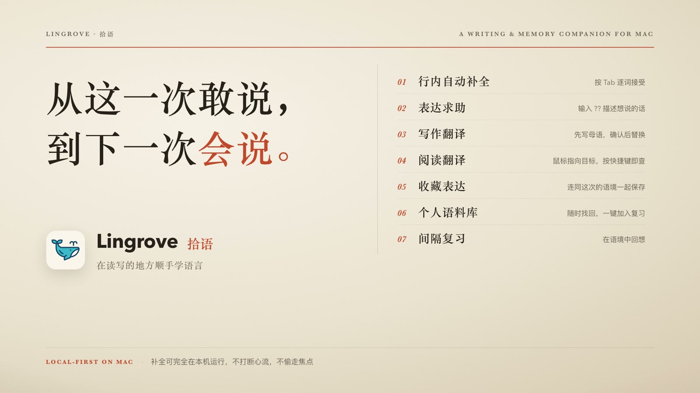
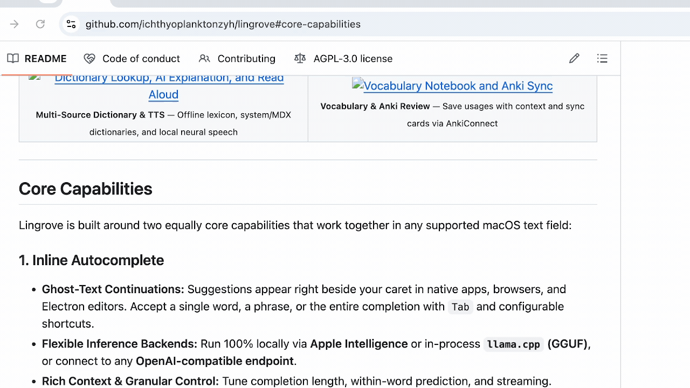
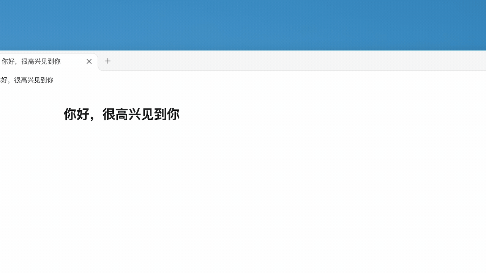

<div align="center">


# 拾语 · Lingrove

**macOS 本地优先的行内自动补全与伴随式语言学习工具。**  
在任意输入框的光标旁获取续写建议、即时翻译句子、描述意思寻找表达、在阅读与写作中随时查词，并构建支持内置 FSRS 复习与 Anki 同步的个人语言语料库——全程无需离开你正在写作的应用。

[**English**](README.md) · [**简体中文**](README.zh-CN.md) · [**官网**](https://lingrove.dev) · [**版本发布 (Releases)**](https://github.com/ichthyoplanktonzyh/lingrove/releases) · [**常见问题 (FAQ)**](FAQ.md) · [**语言学习机制详解**](docs/LANGUAGE_LEARNING.md) · [**问题反馈**](https://github.com/ichthyoplanktonzyh/lingrove/issues)

[](#安装指南)
[](#安装指南)
[](#引擎与模型支持)
[](LICENSE)

</div>

> [!NOTE]
> **开发预览版：** Lingrove 仍在开发中。可查看 [版本发布页面](https://github.com/ichthyoplanktonzyh/lingrove/releases)了解可用下载，或从源码构建。

---

## 界面预览

### 产品演示视频

[](.github/assets/readme/lingrove-demo.mp4?raw=true)

[**点击观看完整演示**](.github/assets/readme/lingrove-demo.mp4?raw=true) · 67 秒 · 1080p · 含音乐与音效。使用虚构内容制作的产品功能动画演示。

### 功能实录

以下为功能操作演示。拾语的五段语言学习演示使用中文界面。

<table align="center">
  <tr>
    <td width="50%" align="center" valign="top">
      <a href="gifs/imessage.gif"></a>
      <br />
      <sub><b>自动补全</b> — 光标旁显示灰字，按 Tab 接受。</sub>
    </td>
    <td width="50%" align="center" valign="top">
      <a href=".github/assets/readme/writing-translation.gif"></a>
      <br />
      <sub><b>写作翻译</b> — 输入后稍作停顿，即可查看译文。</sub>
    </td>
  </tr>
  <tr>
    <td width="50%" align="center" valign="top">
      <a href=".github/assets/readme/expression-assistance.gif"></a>
      <br />
      <sub><b>表达辅助</b> — 描述想表达的意思，选择候选并插入。</sub>
    </td>
    <td width="50%" align="center" valign="top">
      <a href=".github/assets/readme/double-click-lookup.gif"></a>
      <br />
      <sub><b>双击查词</b> — 双击单词，查看语境释义与词典释义。</sub>
    </td>
  </tr>
  <tr>
    <td width="50%" align="center" valign="top">
      <a href=".github/assets/readme/reading-translation.gif"></a>
      <br />
      <sub><b>阅读翻译</b> — 选中网页文字，查看译文或查询含义。</sub>
    </td>
    <td width="50%" align="center" valign="top">
      <a href=".github/assets/readme/save-to-vocabulary.gif"></a>
      <br />
      <sub><b>收藏并打开生词本</b> — 点击鱼尾收藏，再打开对应的生词本条目。</sub>
    </td>
  </tr>
</table>

点击动图可查看大图。补全素材来自 [Cotabby 上游项目](https://github.com/FuJacob/Cotabby#demo)，其余为拾语实录。

---

## 核心能力

拾语（Lingrove）将**行内自动补全**与**伴随式语言学习**作为同等核心的两大支柱，在 macOS 原生应用、浏览器及 Electron 编辑器中无缝协作：

### 1. 行内自动补全 (Inline Autocomplete)

- **光标旁幽灵续写：** 在你输入的停顿间隙，于光标右侧直接渲染灰字补全建议。支持通过 `Tab` 及自定义快捷键按单词、短语或整段采纳。
- **三种推理后端任选：** 支持 **Apple Intelligence**、应用内原生 **`llama.cpp` (GGUF 本地模型)**，或你自行配置的 **OpenAI 兼容 API 端点**。
- **多维上下文与精细控制：** 自由调节建议长度、词内补全与流式输出；可选开启本地屏幕 OCR 视觉上下文与剪贴板参考；支持全局暂停或按指定 App 独立开关。

### 2. 边写边读学语言 (Language Learning While Writing & Reading)

- **表达辅助：** 想好意思却想不起表达或术语时，在光标处输入 `??`（也支持 `？？`），描述你的意思，选择候选后按 Enter 或 Tab 插入。与 AI 解释共用模型，可独立于翻译开启。
- **行内即时翻译与一键替换：** 用母语或外语写作时稍作停顿，光标旁即会浮现不抢焦点的目标语言预览卡片。按 `Control+Option+T` 可直接用译文替换原句，按 `Option+T` 展开双语详情。
- **阅读翻译与鼠标/区域取词：** 阅读时可通过**鼠标选区 (Selection)**、**鼠标指针取词 (Pointer Lookup，优先本地 Vision OCR + AX 回退)** 或**屏幕框选区域 OCR (Screen Region Capture)** 翻译句子或查词，三者均支持按 App 独立授权与配置快捷键。
- **离线短语识别与两阶段多源查词：** 内置 11.5 MB Wiktionary/Kaikki 离线短语词库，无需额外请求大模型即可自动为固定搭配和习语标注下划线。双击或选中任意单词与短语，即可体验两阶段 **AI 语境释义**（先快速返回当前语境词义与所在句译文，展开详情时再按需生成语法与用法深度解析），并可按词条语言与偏好释义语言联查**内置短语库**、**macOS 系统词典**、**导入的 `MDX`/`MDD` 词典**及可选的**在线词典**。
- **无打扰语音朗读 (TTS)：** 点击卡片上的小喇叭即可朗读句子或词条（不抢占打字焦点）。支持 **macOS 系统语音**、基于 `llama.cpp` 的本地 **Qwen3-TTS Base 模型**（支持参考音频音色克隆与流式 PCM 播放），或兼容 `/audio/speech` 的远程接口。
- **个人语料库与三合一工作区（“鱼尾”生词本）：** 生词本窗口现已整合 **个人语料库 (Personal Corpus)**、**复习 (Review)** 与 **进度 (Progress)** 三大模块：
  - **多维组织与知识图谱：** 点击卡片上的鱼尾图标一键收藏词条与原句语境；支持按**词条 (Entry)** 或**语义 (Meaning)** 在**列表与力导向图谱 (Graph View)** 视图中浏览，内置支持 15 种界面语言的**语义分类目录**，可关联概念与交际功能、记录用法模式、对比近义表达，并支持手动新建词条（`⌘N`）或批量导入带例句的 **CSV/TXT 词表**（`⇧⌘I`）。
  - **本地混合语义搜索：** 可按需下载本地多语言 `Qwen3 Embedding 0.6B` 向量模型（约 639 MB），结合关键词与本地向量检索，直接用“自己的话”描述意思来找回已收藏的表达与义项。
  - **原生内置 FSRS 复习与 Anki 同步：** 收藏语料不会默认创建复习任务。你可以将需要记忆的义项明确加入 **Lingrove 内置 FSRS 复习**，或通过 [AnkiConnect](https://ankiweb.net/shared/info/2055492159) 单条/批量发送至 **Anki Desktop**。两者共用可自定义的 **Note、Note Type 与 HTML/CSS 卡片模板体系**（源语料更新时未手改的字段自动同步且保留复习历史，Anki 发送还支持一键复用 TTS 生成词条与例句发音）。
  - **个人学习进度 (Progress)：** 在进度标签页实时查看内置复习的**连续学习天数 (Streak) 与日历热力图**、**分页评分历史堆叠图**以及 **未来 8 档到期预测环形图**。
- **本地 CLI 与 Agent Skill：** 让 agent 通过本地 `lingrove` CLI 查询、保存和分类学习材料。安装可独立使用的 [`lingrove-cli` skill](CLI.md#agent-skill)，即可按义项追加例句、管理语义分类、预览批次并安全重试。

### 辅助写作工具

- **快捷输入增强：** 内置本地**拼写自动纠错 (Autocorrect)**、`:emoji:` 表情快速插入，以及用于行内数学计算与单位换算的 `/` **斜杠宏 (Slash Macros)**。
- **15 种界面语言：** 在 **设置 → 通用 → 界面语言** 中支持简体中文（显示为“拾语”）、繁体中文（“拾語”）、English 等 15 种语言切换，与补全及翻译的目标语言互不干扰。

> 想了解提示词模板、模型 Token 预算、词典优先级规则或输入法（IME）兼容细节？请查阅 [**语言学习机制与模型详解 (docs/LANGUAGE_LEARNING.md)**](docs/LANGUAGE_LEARNING.md)。

---

## 引擎与模型支持

首次引导中的 **使用推荐配置** 会补齐缺少的本地模型配置并下载模型，同时开启补全、写作与选区翻译、表达辅助。解释和表达辅助共用模型，新用户使用系统朗读。已有模型、语言和快捷键会保留；也可以选择 **手动配置**。系统权限仍需按 macOS 提示授权。

每项能力均可**独立配置**本地模型或远程服务——为翻译配置远程 API 绝不会将你的自动补全按键发送到云端，反之亦然。

| 任务类型 | 本地设备端方案 (On-Device) | 自定义远程接口 (Endpoint) |
| :--- | :--- | :--- |
| **自动补全** | • 内置 `llama.cpp`（基座 GGUF 模型）<br>• Apple Intelligence *（需受支持的 Mac 及 macOS 26+）* | 兼容 OpenAI 的 `/v1/completions` 或 `/v1/chat/completions` |
| **句子翻译** | • 内置 `llama.cpp`（支持 `Hy-MT2 1.8B / 7B`、`TranslateGemma 4B`） | 兼容 OpenAI 的 Chat 接口 |
| **AI 解释与表达辅助** | • 内置 `llama.cpp`（通用指令微调 GGUF 模型） | 兼容 OpenAI 的 Chat 接口 |
| **语音朗读 (TTS)** | • Apple macOS 系统语音<br>• 本地 `Qwen3-TTS Base`（`llama.cpp`，约 1.48 GB，支持参考音频） | 兼容 OpenAI 的 `/audio/speech` 接口 |
| **表达语义搜索** | • 可选本地 `Qwen3 Embedding 0.6B`（`llama.cpp`，约 639 MB，关键词 + 向量混合检索） | — |
| **短语识别与 OCR** | • 始终在本地运行（Wiktionary/Kaikki 离线词库 + macOS Vision OCR） | — |

---

## 安装指南

### 系统要求

- **操作系统：** macOS 14.0 (Sonoma) 或更高版本 *（仅在使用 Apple Intelligence 补全时需 macOS 26+）*。
- **硬件架构：** 推荐使用 Apple Silicon (`arm64`) 运行本地 GGUF 与 TTS 推理；具体版本支持的架构请以发布说明为准。

### 方式一：下载安装包

请查看 [版本发布页面](https://github.com/ichthyoplanktonzyh/lingrove/releases)，以具体版本的
安装、签名和平台说明为准；当前源码不保证某个预编译安装包始终可用。

### 方式二：从源码编译（开发者）

```sh
git clone https://github.com/ichthyoplanktonzyh/lingrove.git
cd lingrove
scripts/dev-setup.sh
scripts/prepare_lingrove_workspace.sh
open build/lingrove-dependencies/Lingrove.xcworkspace
```

- 在 Xcode 中选择 **Lingrove Dev** Scheme 可编译 **Lingrove Dev.app**（拥有独立的偏好设置、钥匙串与日志目录，避免污染日常使用环境）；选择 **Lingrove** Scheme 则编译正式版 **Lingrove.app**。
- 本地开发签名使用你自己的 Apple 开发者团队配置（保存在已被 gitignore 的 `LocalSigning.xcconfig` 中）。
- 更多构建与测试说明请参考 [CONTRIBUTING.md](CONTRIBUTING.md) 与 [RELEASING.md](RELEASING.md)。

---

## 快速体验

首次引导中选择 **使用推荐配置**，即可补齐缺少的模型配置并开启推荐功能。等待所需模型下载完成，并授予辅助功能和输入监控权限；也可在 **设置 → 引擎与模型** 中按任务手动配置。

| 想体验的功能 | 操作方法 |
| :--- | :--- |
| **自动补全** | 在受支持的编辑器中输入并稍作停顿，看到灰字后按 `Tab` 接受下一部分建议。 |
| **写作翻译** | 在 **语言学习 → 翻译** 中启用翻译、选择目标语言并开启句子预览。输入一句话后稍作停顿；点击卡片的替换按钮，或按默认的 `Control+Option+T` 将译文写回原文位置。 |
| **表达辅助** | 在 **语言学习 → 解释与表达** 中开启表达辅助，目标语言选择英语。在光标处输入 `??`，在临时输入区描述“只关注支持自己看法的证据，忽略反对证据的心理倾向”。选择候选后按 `Enter` / `Tab` 插入，按 `Esc` 取消。 |
| **双击查词** | 双击拾语翻译卡片中的单词或带下划线的表达，在查询窗口中切换 **语境释义** 与 **词典释义**。 |
| **阅读翻译与取词** | 在 **语言学习 → 翻译** 中按需开启选区翻译、鼠标指针取词或框选区域 OCR，并允许需要取词的应用。选中文字、指向单词按下取词快捷键或框选屏幕区域，即可查看译文或查词。 |
| **个人语料库与复习** | 点击卡片上的鱼尾图标将内容收入语料库；从菜单栏打开 **生词本**，即可在列表或图谱视图中整理词义、将义项选入**内置复习**或发送至 **Anki**，并在 **进度** 页查看学习统计。 |

目标语言和解释语言在 **语言学习** 中设置，快捷键可在 **设置 → 快捷键** 中调整；你也可以随时通过应用内的 **使用指南 (Usage Guide)** 体验交互式场景演示，或在菜单栏弹窗中快速切换补全与学习开关。更完整的交互说明见 [语言学习机制与模型详解](docs/LANGUAGE_LEARNING.md)。

---

## 系统权限说明

拾语仅在对应功能启用时请求必要的 macOS 系统权限。**所有密码框与安全输入字段均被严格拦截，绝不读取或插入任何内容。**

| 权限名称 | 是否必需 | 用途说明 |
| :--- | :--- | :--- |
| **辅助功能 (Accessibility)** | **必需** | 读取当前焦点输入框上下文、定位光标位置，以及将采纳的补全或译文写回输入框。 |
| **输入监控 (Input Monitoring)** | **必需** | 在不抢占焦点的情况下感知打字停顿、取消键 (`Esc`) 与采纳快捷键 (`Tab`)。 |
| **屏幕录制 (Screen Recording)** | *可选* | 仅在开启“屏幕视觉上下文”、“框选区域 OCR 翻译”或“鼠标取词 OCR 回退”时按需使用。 |

---

## 隐私与数据安全

- **默认本地运行：** Apple Intelligence、本地 `llama.cpp` GGUF 模型、屏幕截图与 Vision OCR、离线短语识别与词典查询均在 Mac 本机完成。
- **远程请求严格受限：** 只有当你主动将某项任务配置为远程 Endpoint 时，该任务的有限文本上下文才会发送至你指定的服务端。语言学习请求绝不附带无关剪贴板内容或打字历史。
- **输入历史加密且默认关闭：** 输入历史记录默认关闭；开启后数据以加密归档形式存储在本地，密钥保存在 macOS 钥匙串（Keychain）中，可随时在设置中一键清空。
- **隐私：** 本地使用无需账号。账户与同步为可选功能，使用用户配置的服务；应用没有内置数据统计或远程崩溃上传。自动更新在独立 Sparkle 源与签名就绪前保持关闭。
- **应用数据完全隔离：** `Lingrove`、`Lingrove Dev` 与原 `Cotabby` 使用各自独立的偏好设置、钥匙串服务与存储目录，互不覆盖。详见 [FORK.md](FORK.md)。

---

## 项目文档与社区

文档导航及各文档的职责见 [docs/README.md](docs/README.md)。

- [**FAQ.md**](FAQ.md) — 关于安装、离线使用、权限与更新机制的常见问题解答
- [**docs/LANGUAGE_LEARNING.md**](docs/LANGUAGE_LEARNING.md) — 翻译交互细节、多源词典机制、TTS 生命周期与模型 Token 预算说明
- [**仓库职责与移动端**](docs/REPOSITORY_BOUNDARIES.md) — 原生 Mac、共享核心和独立移动端私有仓库
- [**ARCHITECTURE.md**](ARCHITECTURE.md) & [**SOURCE_LAYOUT.md**](SOURCE_LAYOUT.md) — 架构边界设计与源码目录导航
- [**CONTRIBUTING.md**](CONTRIBUTING.md) & [**CODE_OF_CONDUCT.md**](CODE_OF_CONDUCT.md) — 参与贡献、运行评测套件与提交 Issue / PR 指南

---

## 维护者、项目渊源与开源协议

**Lingrove（拾语）** 由 [ichthyoplanktonzyh](https://github.com/ichthyoplanktonzyh) 独立维护。  
本项目衍生自 [FuJacob/Cotabby](https://github.com/FuJacob/cotabby)（由 [FuJacob](https://github.com/FuJacob) 创建，并与 [jam-cai](https://github.com/jam-cai)、[akramj13](https://github.com/akramj13)、McHamster 等贡献者共同开发），原作著作权与贡献均予以完整保留和致谢。

项目基于 [CotabbyInference](https://github.com/FuJacob/cotabbyinference)、[llama.cpp](https://github.com/ggml-org/llama.cpp)、[Sparkle](https://github.com/sparkle-project/Sparkle)、[swift-log](https://github.com/apple/swift-log)、[LaunchAtLogin](https://github.com/sindresorhus/LaunchAtLogin-Modern)、[SymSpell](https://github.com/wolfgarbe/SymSpell)、[Grape](https://github.com/li3zhen1/Grape)、[Easydict MDictReader](https://github.com/tisfeng/Easydict)、[Nibomo UI 组件](docs/MAC_REVIEW_ACCOUNT_UI_REUSE.md) 及 [GitHub gemoji](https://github.com/github/gemoji) 等优秀开源组件构建。内置词典、语义分类目录与短语数据的许可说明详见 [THIRD_PARTY_LICENSES.md](THIRD_PARTY_LICENSES.md)、[VocabularyClassificationCatalog.NOTICE.md](Lingrove/Resources/VocabularyClassificationCatalog.NOTICE.md) 与 [learning-expressions.NOTICE.md](Lingrove/Resources/learning-expressions.NOTICE.md)。

本项目遵循 [**GNU Affero General Public License v3.0 (AGPLv3)**](LICENSE) 开源协议。第三方库、词典数据与模型权重保留其各自的原始许可条款。
