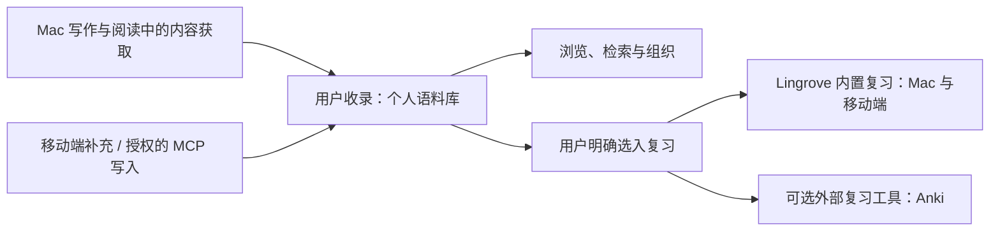

# Lingrove 产品定位与业务模型

更新日期：2026 年 11 月 9 日。

本文件记录 Mac 与移动端共同遵循的产品定位、平台分工和业务规则。它描述已确认的
目标与业务规则。术语定义见 [CONTEXT.md](../CONTEXT.md)，原生 Mac 当前状态见
[Mac 维护说明](MAC_WORKSPACE.md)，移动端与服务的实现/验收见
[独立仓库](REPOSITORY_BOUNDARIES.md)。

## 产品定位

Lingrove 帮助用户在真实读写中接触语言，积累和组织自己的语言材料，并选择其中
需要记忆的内容进行复习。当前称为「生词本」的功能，在业务上是个人语言语料库：
它可以长期用于理解、查阅、检索和积累，不要求每份资料都成为复习任务。

Mac 的自动补全仍是并列的核心能力，写作辅助与语言学习可以独立使用。接受补全、
查看翻译或查词本身，不等于授权收录到语料库，更不等于加入复习。

共同的内容主线是：

## 平台分工

| 平台 | 当前产品职责 | 范围约束 |
| --- | --- | --- |
| Mac | 自动补全和写作辅助；通过写作翻译、阅读翻译、词义查阅等获得材料；收录、组织和检索个人语料；提供选入与执行内置复习的完整闭环 | 现有能力保持；桌面端已有原生内置复习、账户同步与个人进度；真实服务/物理设备验收仍须按范围完成 |
| iPhone / iPad | 随时浏览、编辑和补充个人语料库；执行同一套内置复习并查看进度 | 当前先完成语料库、同步、MCP 与复习；移动端内置 AI 对话等内容扩充工具属于后续方向 |
| 服务端 / MCP | 让授权客户端访问同一份语料内容，并同步必要的复习选择与内置复习数据 | 保存语料与选入复习是不同业务操作；MCP 保存资料不隐式创建复习任务 |

两端的使用重心不同，但不是两套独立的个人语料或内置复习系统。用户在 Mac 选入的
内容及其内置复习进度，应能在移动端接续，反向亦然；跨端同步与离线冲突需要实际
验证。Anki 自己拥有的调度和历史独立保留，不与内置复习进度强行合并。

原生 Mac 已接入共享语料、账户同步、内置复习及个人进度；当前组织与验证边界见
[Mac 维护说明](MAC_WORKSPACE.md)。移动端保持独立界面，原生 Mac 不迁往 Catalyst。
跨端一致性与实际设备/服务验收仍需按所修改范围确认。

2026-11-02 用户确认当前没有任何用户数据。后续开发不承担旧开发快照、旧 schema/
备份或 Anki 绑定/历史的数据迁移兼容要求，可以按当前业务简化模型与实现。现有组件
作为复用基础，不必为历史输入增加适配层；此调整不取消用户今后使用中对保存、重启、
跨设备一致性及手工修改/评分历史的保护。移动端本轮不新增 Anki 连接或历史迁移功能。

2026-11-03 的显式迁移后，安装中的 Lingrove Dev 已包含真实用户语料。后续模块开发与
验收只使用合成数据和隔离宿主，不访问或替换安装中的应用及其数据。当前结构的正常
版本升级仍须保护已有语料、手工修改和复习历史；不承担旧开发快照兼容不等于可以
清空当前数据库。

## 四个业务层次

| 层次 | 拥有的内容 | 与下一层的关系 |
| --- | --- | --- |
| 内容与理解 | 原文和来源、表达、义项、出现位置、解释判断、例句、翻译、已保存解释 | 可以先保留材料再整理；义项稳定身份不由解释文字或例句位置决定 |
| 个人语料库 | 已收录的词条、义项和用例，以及笔记、标签、富内容、意义关联和分类 | 收录后即可浏览和整理，复习由用户另行选入 |
| 复习选入与准备 | 用户明确选择的义项、目标复习工具、参与状态和复习材料方案 | 只有明确选入才建立相应复习参与；保存准备草稿不表示开始调度 |
| 复习执行与记录 | 内部练习、队列、评分、调度状态和复习事件 | 内置复习跨 Mac/移动端接续；内容编辑不得隐式清空既有历史 |

手动新建、查词或翻译后明确保存及授权工具写入，都保存到同一个语料库。
笔记、标签和富内容属于义项。采用并关联到义项的解释判断作为用例展示。用户可以直接
管理词条、义项和用例，并为需要记忆的义项单独选择复习。

## 义项详情与内容归属

词头、义项、语义节点是语料库的核心概念。义项是一等内容单位，拥有当前简明释义、
统一的用法说明和例句；语义节点组织跨词头的相关义项。Agent 负责知识整理，日常详情
以阅读和浏览为主。采集来源不决定义项是否具有解释能力。

Mac 详情保留现有图标、组件、样式和页内词典。用法说明由义项富内容承载，图片仍使用
现有媒体关系。个人批注保留独立所有权；例句显示原文、翻译和来源，不要求另写一份
“此处含义”。生成和解释判断的原始记录用于溯源，不作为正文或复习答案的回退来源。

Agent `capture` 的义项可提供 `explanation`，直接生成义项正文；例句中的 `meaning` 和
`meaningLanguage` 不再属于该写入契约。对现有正文的替换使用带 `expectedRevision` 的
`update.explanation`；追加例句不得隐式替换解释。更新正文不改变义项、用例或复习身份。

## 收藏、整理与外部材料

收藏不额外调用模型进行义项匹配。当前采集已有的简明释义进入义项，已生成的详细解释
进入义项正文。同一采集重复保存保持原有身份；不同采集可以暂时形成表达同一意思的
不同义项。释义措辞、备注和标签不作为义项身份或自动归并依据。

用户可把同一词头内的义项 A 拖入 B，或通过行菜单选择目标；Agent 使用相同的明确合并
操作。B 的 ID、释义、正文、备注、标签和语义关联保留，A 的例句迁入 B，保留翻译和来源。
不同来源的相同句子不会因文字相同而在合并时被丢弃。A 的义项记录移除，历史身份只为
引用完整性保留。来源的语义关联不会自动转移，也不会删除仍可复用的语义节点。

用户合并可在下一次语料写入前撤销；撤销恢复双方内容、例句、关联及被移除的图片。
账户或版本变化后拒绝旧快照恢复。迟到的解释结果不会覆盖手工清空的正文或合并后的
目标内容。普通编辑仍使用既有字段冲突检查。

移除通用 CSV/TXT 直接导入、字段映射与逐行建义项链路。外部材料由 Agent 读取、结合
上下文确认义项，并通过 CLI/MCP 明确新增、追加、修改或合并；应用不再执行自动语义判断。
原生备份恢复保留已有身份与关系，不承担义项识别。批量写入仍保持事务、版本校验和
重试幂等性。仅有词头的材料需要明确收录范围，不能默认展开全部词典义项。

## 已确认的核心规则

1. **收录后可明确选入复习。** 用户可以积累很多语料，只挑选其中一部分进行记忆。
   新建、编辑、导入或经授权工具保存资料，都不能借保存动作隐式创建复习任务。
2. **义项是当前的复习归属。** 词条用于浏览与聚合多义项；用户选择一个义项，不应
   自动选入同一词条的其他义项。例句提供上下文和材料，不提供独立制卡能力。
3. **复习选入是明确操作。** 从语料库的义项或多选结果进入复习系统；界面可以使用
   「加入复习」等业务语言，不要求普通用户先管理卡片、牌组或关联记录。
4. **准备与执行分离。** 选用例句、调整提示和答案属于复习材料准备；具体练习与
   调度由复习系统负责。原有编辑器可以作为进阶能力，不必成为每次选入的必经步骤。
5. **例句变化不转移学习对象。** 删除、替换或移动所选例句，不应把原义项的记忆
   进度转给另一个义项；义项合并则需要显式处理存活身份及其已有记录。
6. **语料与复习各自拥有数据。** 修改笔记或释义不是新建学习对象；删除练习不能
   删除语料；删除语料时保留复习历史。暂停/退出的具体规则另行确定。
7. **内置复习属于 Lingrove。** Mac 和移动端是它的两个客户端；Nibomo 是复用的
   技术底座，不是用户必须另行配置的第二个产品。Anki 是可选的外部复习工具。
8. **状态展示保持真实。** 未加入复习的资料显示「未加入复习」，不计入待复习。
   加入后的首次学习、调度进度与暂停等状态需要区别呈现；内部多张练习不能重复算作
   多个词条。具体进度口径随复习模型验收，不提前以卡片总数代替语料或词汇总数。

## 当前复习旅程与共享模型

外层为个人语料库、复习、进度；复习中 Lingrove 与 Anki 是并列目标，参与、调度与历史
各自独立。用户在语料库明确选择加入 Lingrove 复习后继续阅读，再从复习首页明确开始
一轮。当前默认路径使用默认 Note Type，关联义项与例句；模板和自定义字段编辑是可选操作。
取消准备或普通保存语料不隐式加入复习。发送到 Anki 也是明确操作。

Note 保存来源绑定及自定义字段；Note Type 定义字段、卡片模板和样式；Card 按模板生成，
保有独立调度和历史。来源、类型或字段变化不应丢失用户编辑或评分。Anki 与内置复习可
共享 Note 内容，但互不接管对方的调度。当前行为、旧练习边界及具体限制以
[Note 与卡片模板](REVIEW_TEMPLATE_DESIGN.md)和 [Anki 发送](ANKI_NOTE_SYNC.md)为准。

复习总览区分未加入、待复习、未到期、暂停、材料不可用及实际完成一轮等状态；普通
导航不会自动启动复习。同步必须保留账户、工作区、原子提交及确认边界；本地通过不
代表线上部署或真实跨设备验收。

## Nibomo 的复用方式

复用 Card/Deck、FSRS、队列、会话、评分、历史、媒体、事务、同步和原生界面模式，
由 Lingrove 的语料与复习选入业务驱动。独立卡片与语料关联练习可以使用同一底座，
两类练习各自使用自己的来源身份。旧数据迁移不作为当前验收条件。

语料库和复习分别维护内容与练习状态。
移动端已新增独立复习选入、练习映射和历史来源的原生数据层，修正了例句移动改变
复习归属的路径；本地事务与队列准入、iPhone/iPad 的首个本地操作闭环已通过定向
验收。第三波补齐材料准备、逐字段来源跟随、多练习和内置复习同步；本地双模拟器已接续；真实身份/物理设备
操作仍需独立验收，不将本地协议通过计作完整产品上线。

## 交付边界与当前证据

- Mac 内容获取、原有语料页面和 Anki 适配保留；新增账户、同步、原生内置复习和真实
  个人统计。外层只含个人语料库/复习/进度，菜单栏与已有设置入口保持，见 MAC_WORKSPACE.md。
- 移动端语料管理、账户/媒体/复习同步和四个授权 MCP 工具已实现，代码独立在私有
  lingrove-mobile。双模拟器接续与真实 ChatGPT 私有 Tunnel → 普通 iPhone 的关键旅程
  已执行；其存储、图片与未选入复习的结果已核对。SDK、模拟器和真实客户端证据分开。
- 真实用户 OAuth/邮箱、物理设备、自有 HTTPS 云服务及完整离线接续仍未验收，未部署。
  Files/Photos/RTL/大字号等补充缺口在移动仓库 docs/lingrove-product.md 中维护。
- 移动生词本入口暂留 Cards，完整 UI 重设计后置。端侧 embedding/语义搜索及 AI 对话
  后置，不成为当前保存/复习的前置条件。
- 同步只处理用户明确启用的语料、资源及复习数据。自动补全上下文、未保存截图、临时
  翻译与日志不因此默认进入语料库或上传；未来服务接线延续零遥测约定。

## 已确定的移动复习规则与后续边界

- 提示、答案和标签仍等于上次生成值时跟随来源；已手改的字段保留，调度与评分不重置。
- 暂停/退出停止入队并保留历史，再次加入
  沿用尚存练习；全部练习已删除后可明确重新选入。义项数与练习数分开统计。
- 来源消失时先暂停材料准入，用户可明确使用保存材料继续原义项的复习；不伪造新语料。
  离线历史明确接纳到新账户时保留原出处与评分，单独记录有限的历史导入授权。
- 并发评分保留独立事件，Card 快照按既定时钟裁决。当前评分的撤销恢复服务端保存的
  先前调度；若已有其他设备的新评分胜出，旧撤销只留记录。该规则不从历史重放 FSRS。
- 桌面内置复习已接入原生窗口；后续界面继续完善。两端必须使用同一套
  业务身份和同步契约，不能各自形成一套独立进度。

「收录不默认复习」和「例句不独立制卡」始终是跨端业务规则。
