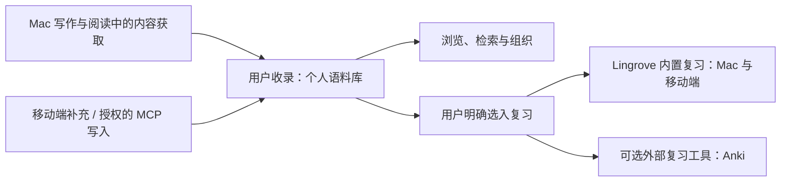

# Lingrove 产品定位与业务模型

更新日期：2026 年 11 月 3 日。

本文件记录 Mac 与移动端共同遵循的产品定位、平台分工和业务规则。它描述已确认的
目标与业务规则。术语定义见 [CONTEXT.md](../CONTEXT.md)，原生 Mac 当前状态见
[Mac 维护说明](MAC_WORKSPACE.md)，移动端与服务的实现/验收见
[独立仓库](REPOSITORY_BOUNDARIES.md)。

## 产品定位

Lingrove 帮助用户在真实读写中接触语言，积累和组织自己的语言材料，并选择其中
需要记忆的内容进行复习。当前称为「生词本」的功能，在业务上是个人语言语料库：
它可以长期用于理解、查阅、检索和积累，不要求每份资料都成为复习任务。

Mac 的自动补全仍是并列的核心能力，写作辅助与语言学习可以独立使用。接受补全、
查看翻译或查词本身，不等于授权收录到语料库，更不等于加入复习。

共同的内容主线是：

## 平台分工

| 平台 | 当前产品职责 | 范围约束 |
| --- | --- | --- |
| Mac | 自动补全和写作辅助；通过写作翻译、阅读翻译、词义查阅等获得材料；收录、组织和检索个人语料；提供选入与执行内置复习的完整闭环 | 现有能力保持；桌面端已有原生内置复习、账户同步与个人进度；真实服务/物理设备验收仍须按范围完成 |
| iPhone / iPad | 随时浏览、编辑和补充个人语料库；执行同一套内置复习并查看进度 | 当前先完成语料库、同步、MCP 与复习；移动端内置 AI 对话等内容扩充工具属于后续方向 |
| 服务端 / MCP | 让授权客户端访问同一份语料内容，并同步必要的复习选择与内置复习数据 | 保存语料与选入复习是不同业务操作；MCP 保存资料不隐式创建复习任务 |

两端的使用重心不同，但不是两套独立的个人语料或内置复习系统。用户在 Mac 选入的
内容及其内置复习进度，应能在移动端接续，反向亦然；跨端同步与离线冲突需要实际
验证。Anki 自己拥有的调度和历史独立保留，不与内置复习进度强行合并。

原生 Mac 已接入共享语料、账户同步、内置复习及个人进度；当前组织与验证边界见
[Mac 维护说明](MAC_WORKSPACE.md)。移动端保持独立界面，原生 Mac 不迁往 Catalyst。
跨端一致性与实际设备/服务验收仍需按所修改范围确认。

2026-11-02 用户确认当前没有任何用户数据。后续开发不承担旧开发快照、旧 schema/
备份或 Anki 绑定/历史的数据迁移兼容要求，可以按当前业务简化模型与实现。现有组件
作为复用基础，不必为历史输入增加适配层；此调整不取消用户今后使用中对保存、重启、
跨设备一致性及手工修改/评分历史的保护。移动端本轮不新增 Anki 连接或历史迁移功能。

2026-11-03 的显式迁移后，安装中的 Lingrove Dev 已包含真实用户语料。后续模块开发与
验收只使用合成数据和隔离宿主，不访问或替换安装中的应用及其数据。当前结构的正常
版本升级仍须保护已有语料、手工修改和复习历史；不承担旧开发快照兼容不等于可以
清空当前数据库。

## 四个业务层次

| 层次 | 拥有的内容 | 与下一层的关系 |
| --- | --- | --- |
| 内容与理解 | 原文和来源、表达、义项、出现位置、解释判断、例句、翻译、已保存解释 | 可以先保留材料再整理；义项稳定身份不由解释文字或例句位置决定 |
| 个人语料库 | 用户的收录选择，以及笔记、标签、富内容、意义关联、分类和组织 | 收藏只表示收录；完全不参与复习也能独立使用 |
| 复习选入与准备 | 用户明确选择的义项、目标复习工具、参与状态和复习材料方案 | 只有明确选入才建立相应复习参与；保存准备草稿不表示开始调度 |
| 复习执行与记录 | 内部练习、队列、评分、调度状态和复习事件 | 内置复习跨 Mac/移动端接续；内容编辑不得隐式清空既有历史 |

知识判断是否采用、内容是否收藏、义项是否加入复习，是不同业务状态。不能从其中
一个状态推断另一个状态，也不能把「资料记录存在」当成「个人已收藏」或「应排入
今日复习」的证据。

## 已确认的核心规则

1. **收藏不默认加入复习。** 用户可以积累很多语料，只挑选其中一部分进行记忆。
   新建、编辑、导入或经授权工具保存资料，都不能借保存动作隐式创建复习任务。
2. **义项是当前的复习归属。** 词条用于浏览与聚合多义项；用户选择一个义项，不应
   自动选入同一词条的其他义项。例句提供上下文和材料，不提供独立制卡能力。
3. **复习选入是明确操作。** 从语料库的义项或多选结果进入复习系统；界面可以使用
   「加入复习」等业务语言，不要求普通用户先管理卡片、牌组或关联记录。
4. **准备与执行分离。** 选用例句、调整提示和答案属于复习材料准备；具体练习与
   调度由复习系统负责。原有编辑器可以作为进阶能力，不必成为每次选入的必经步骤。
5. **例句变化不转移学习对象。** 删除、替换或移动所选例句，不应把原义项的记忆
   进度转给另一个义项；义项合并则需要显式处理存活身份及其已有记录。
6. **语料与复习各自拥有数据。** 修改笔记或释义不是新建学习对象；删除练习不能
   删除语料；取消收藏也不能借数据库级联删除复习历史。暂停/退出的具体规则另行确定。
7. **内置复习属于 Lingrove。** Mac 和移动端是它的两个客户端；Nibomo 是复用的
   技术底座，不是用户必须另行配置的第二个产品。Anki 是可选的外部复习工具。
8. **状态展示保持真实。** 未加入复习的资料显示「未加入复习」，不计入待复习。
   加入后的首次学习、调度进度与暂停等状态需要区别呈现；内部多张练习不能重复算作
   多个词条。具体进度口径随复习模型验收，不提前以卡片总数代替语料或词汇总数。

## 已确认的共享制卡与 Mac 复习旅程

以下是本轮实现与验收的产品约束；执行证据和真实服务采用边界分别记录在
MAC_WORKSPACE.md，不能从本地功能或协议测试推断服务已经部署。

- 外层保持个人语料库、复习、进度。复习内部明确提供 Lingrove 与 Anki 两个同层级
  目标；同一义项可分别加入，两者各自拥有参与状态、调度和历史。
- 材料组合、模板、编辑和解析由 Lingrove 共用边界负责。表达、释义、例句、翻译、
  解释、笔记、挖空、图片、自定义内容和音频不因目标不同而重复实现编辑器。Anki
  牌组、笔记类型、字段映射和远端冲突由 Anki 适配负责，不成为内置制卡前置条件。
- 内置练习保存可重新编辑的材料方案、稳定来源及生成基线。更新来源保留组合顺序与
  手工修改，编辑材料沿用原练习身份，不重置评分或调度。媒体使用对应目标的受管理
  资源引用，不把 Anki HTML、私有媒体文件名或绑定当成内置材料。
- 首次准备通过明确标注的「加入复习」一次提交材料与复习参与；已有练习的「保存」
  只更新材料，不改变参与或清空历史。本轮没有独立的持久化未选入草稿库；取消准备
  不产生卡片、媒体或复习参与写入，保存模板也不提交当前卡片草稿。
- 语料详情显示两种目标的真实状态和明确操作；多选结果同时提供内置选入及 Anki
  准备路径。普通保存语料、保存模板和取消材料准备均不隐式选入复习。
- 普通打开复习进入总览，明确开始才启动一轮。无语料、尚未选入、存在待复习内容、
  暂未到期、全部暂停、来源不可用与实际完成一轮分别呈现，不能把空队列一律当成完成。
- 找到待加入内容与管理已加入内容是不同操作。已加入、暂停、退出和材料修复有可发现
  的入口；复习执行显示实际本轮进展，完成反馈限定于本轮与所选范围，并可返回总览、
  查看后续安排及进度。
- 设置与引导明确区分 Lingrove 和 Anki；界面只保留动作、状态、必要错误与确认。
  架构、内部身份或与当前操作无关的解释不进入用户界面。
- 本轮同时包含入口与空状态、批量选入、完成反馈，以及内容管理、共用材料编辑、
  设置与引导两部分工作。共享制卡是它们的基础，不替代任何一部分旅程。
- 新的共享材料或媒体同步契约须保留账户与工作区边界、原子提交和确认语义。旧服务
  不支持的契约不能被当成成功同步或通过丢弃材料确认；共享代码往返校验、服务端采用
  以及真实多端验收分别记录，独立移动/服务仓库仍遵循现有快照流程。

## Nibomo 的复用方式

复用 Card/Deck、FSRS、队列、会话、评分、历史、媒体、事务、同步和原生界面模式，
由 Lingrove 的语料与复习选入业务驱动。独立卡片与语料关联练习可以使用同一底座，
不通过虚构义项或自动收藏来混淆两种业务。旧数据迁移不作为当前验收条件。

个人语料库不是一组正反面文本，卡片存在也不是收藏或复习选入的通用替代信号。
移动端已新增独立复习选入、练习映射和历史来源的原生数据层，修正了例句移动改变
复习归属的路径；本地事务与队列准入、iPhone/iPad 的首个本地操作闭环已通过定向
验收。第三波补齐材料准备、逐字段来源跟随、多练习和内置复习同步；本地双模拟器已接续；真实身份/物理设备
操作仍需独立验收，不将本地协议通过计作完整产品上线。

## 交付边界与当前证据

- Mac 内容获取、原有语料页面和 Anki 适配保留；新增账户、同步、原生内置复习和真实
  个人统计。外层只含个人语料库/复习/进度，菜单栏与已有设置入口保持，见 MAC_WORKSPACE.md。
- 移动端语料管理、账户/媒体/复习同步和四个授权 MCP 工具已实现，代码独立在私有
  lingrove-mobile。双模拟器接续与真实 ChatGPT 私有 Tunnel → 普通 iPhone 的关键旅程
  已执行；其存储、图片与未选入复习的结果已核对。SDK、模拟器和真实客户端证据分开。
- 真实用户 OAuth/邮箱、物理设备、自有 HTTPS 云服务及完整离线接续仍未验收，未部署。
  Files/Photos/RTL/大字号等补充缺口在移动仓库 docs/lingrove-product.md 中维护。
- 移动生词本入口暂留 Cards，完整 UI 重设计后置。端侧 embedding/语义搜索及 AI 对话
  后置，不成为当前保存/复习的前置条件。
- 同步只处理用户明确启用的语料、资源及复习数据。自动补全上下文、未保存截图、临时
  翻译与日志不因此默认进入语料库或上传；未来服务接线延续零遥测约定。

## 已确定的移动复习规则与后续边界

- 提示、答案和标签仍等于上次生成值时跟随来源；已手改的字段保留，调度与评分不重置。
- 当前移动实现中，取消收藏不改变复习参与；暂停/退出停止入队并保留历史，再次加入
  沿用尚存练习；全部练习已删除后可明确重新选入。义项数与练习数分开统计。
- 来源消失时先暂停材料准入，用户可明确使用保存材料继续原义项的复习；不伪造新语料。
  离线历史明确接纳到新账户时保留原出处与评分，单独记录有限的历史导入授权。
- 并发评分保留独立事件，Card 快照按既定时钟裁决。当前评分的撤销恢复服务端保存的
  先前调度；若已有其他设备的新评分胜出，旧撤销只留记录。该规则不从历史重放 FSRS。
- 桌面内置复习已接入原生窗口；后续界面继续完善。两端必须使用同一套
  业务身份和同步契约，不能各自形成一套独立进度。

「收录不默认复习」和「例句不独立制卡」始终是跨端业务规则。
