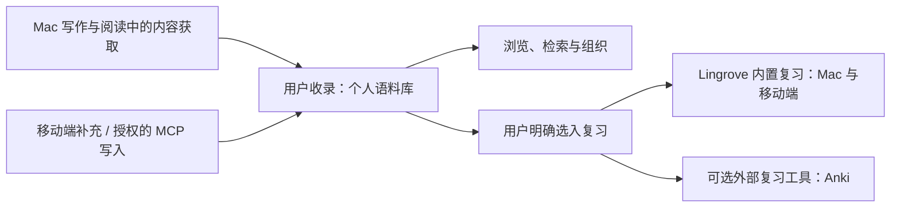

# Lingrove 产品定位与业务模型

更新日期：2026 年 11 月 2 日。

本文件记录 Mac 与移动端共同遵循的产品定位、平台分工和业务规则。它描述已确认的
目标，不声明相关功能已经交付；术语定义见 [CONTEXT.md](../CONTEXT.md)，移动端的
实现与验收状态继续在 [实施计划](MOBILE_NOTEBOOK_PLAN.md) 中追踪。

## 产品定位

Lingrove 帮助用户在真实读写中接触语言，积累和组织自己的语言材料，并选择其中
需要记忆的内容进行复习。当前称为「生词本」的功能，在业务上是个人语言语料库：
它可以长期用于理解、查阅、检索和积累，不要求每份资料都成为复习任务。

Mac 的自动补全仍是并列的核心能力，写作辅助与语言学习可以独立使用。接受补全、
查看翻译或查词本身，不等于授权收录到语料库，更不等于加入复习。

共同的内容主线是：

## 平台分工

| 平台 | 当前产品职责 | 范围约束 |
| --- | --- | --- |
| Mac | 自动补全和写作辅助；通过写作翻译、阅读翻译、词义查阅等获得材料；收录、组织和检索个人语料；提供选入与执行内置复习的完整闭环 | 现有能力保持；桌面端内置复习需要正式建设和验收，不能用 Anki 跳转或移动端界面代替 |
| iPhone / iPad | 随时浏览、编辑和补充个人语料库；执行同一套内置复习并查看进度 | 当前先完成语料库、同步、MCP 与复习；移动端内置 AI 对话等内容扩充工具属于后续方向 |
| 服务端 / MCP | 让授权客户端访问同一份语料内容，并同步必要的复习选择与内置复习数据 | 保存语料与选入复习是不同业务操作；MCP 保存资料不隐式创建复习任务 |

两端的使用重心不同，但不是两套独立的个人语料或内置复习系统。用户在 Mac 选入的
内容及其内置复习进度，应能在移动端接续，反向亦然；跨端同步与离线冲突需要实际
验证。Anki 自己拥有的调度和历史独立保留，不与内置复习进度强行合并。

移动端第三波已按其独立范围交付及整合；原验收不代表 Mac 新能力已经完成。用户现已
另行授权原生 Mac 两波建设，见 [Mac 统一底座计划](MAC_INTEGRATION_PLAN.md)：先提取
共享语料/复习与账户/同步核心，再接现有 Mac 的内容获取、生词本、账户同步和内置
复习。移动端不是改成 Mac 的界面，原生 Mac 也不迁往 Catalyst。具体已通过与未验证
内容以各波交付/整合记录为准。

2026-11-02 用户确认当前没有任何用户数据。后续开发不承担旧开发快照、旧 schema/
备份或 Anki 绑定/历史的数据迁移兼容要求，可以按当前业务简化模型与实现。现有组件
作为复用基础，不必为历史输入增加适配层；此调整不取消用户今后使用中对保存、重启、
跨设备一致性及手工修改/评分历史的保护。移动端本轮不新增 Anki 连接或历史迁移功能。

## 四个业务层次

| 层次 | 拥有的内容 | 与下一层的关系 |
| --- | --- | --- |
| 内容与理解 | 原文和来源、表达、义项、出现位置、解释判断、例句、翻译、已保存解释 | 可以先保留材料再整理；义项稳定身份不由解释文字或例句位置决定 |
| 个人语料库 | 用户的收录选择，以及笔记、标签、富内容、意义关联、分类和组织 | 收藏只表示收录；完全不参与复习也能独立使用 |
| 复习选入与准备 | 用户明确选择的义项、目标复习工具、参与状态和复习材料方案 | 只有明确选入才建立相应复习参与；保存准备草稿不表示开始调度 |
| 复习执行与记录 | 内部练习、队列、评分、调度状态和复习事件 | 内置复习跨 Mac/移动端接续；内容编辑不得隐式清空既有历史 |

知识判断是否采用、内容是否收藏、义项是否加入复习，是不同业务状态。不能从其中
一个状态推断另一个状态，也不能把「资料记录存在」当成「个人已收藏」或「应排入
今日复习」的证据。

## 已确认的核心规则

1. **收藏不默认加入复习。** 用户可以积累很多语料，只挑选其中一部分进行记忆。
   新建、编辑、导入或经授权工具保存资料，都不能借保存动作隐式创建复习任务。
2. **义项是当前的复习归属。** 词条用于浏览与聚合多义项；用户选择一个义项，不应
   自动选入同一词条的其他义项。例句提供上下文和材料，不提供独立制卡能力。
3. **复习选入是明确操作。** 从语料库的义项或多选结果进入复习系统；界面可以使用
   「加入复习」等业务语言，不要求普通用户先管理卡片、牌组或关联记录。
4. **准备与执行分离。** 选用例句、调整提示和答案属于复习材料准备；具体练习与
   调度由复习系统负责。原有编辑器可以作为进阶能力，不必成为每次选入的必经步骤。
5. **例句变化不转移学习对象。** 删除、替换或移动所选例句，不应把原义项的记忆
   进度转给另一个义项；义项合并则需要显式处理存活身份及其已有记录。
6. **语料与复习各自拥有数据。** 修改笔记或释义不是新建学习对象；删除练习不能
   删除语料；取消收藏也不能借数据库级联删除复习历史。暂停/退出的具体规则另行确定。
7. **内置复习属于 Lingrove。** Mac 和移动端是它的两个客户端；Nibomo 是复用的
   技术底座，不是用户必须另行配置的第二个产品。Anki 是可选的外部复习工具。
8. **状态展示保持真实。** 未加入复习的资料显示「未加入复习」，不计入待复习。
   加入后的首次学习、调度进度与暂停等状态需要区别呈现；内部多张练习不能重复算作
   多个词条。具体进度口径随复习模型验收，不提前以卡片总数代替语料或词汇总数。

## Nibomo 的复用方式

复用 Card/Deck、FSRS、队列、会话、评分、历史、媒体、事务、同步和原生界面模式，
由 Lingrove 的语料与复习选入业务驱动。独立卡片与语料关联练习可以使用同一底座，
不通过虚构义项或自动收藏来混淆两种业务。旧数据迁移不作为当前验收条件。

个人语料库不是一组正反面文本，卡片存在也不是收藏或复习选入的通用替代信号。
移动端已新增独立复习选入、练习映射和历史来源的原生数据层，修正了例句移动改变
复习归属的路径；本地事务与队列准入、iPhone/iPad 的首个本地操作闭环已通过定向
验收。第三波补齐材料准备、逐字段来源跟随、多练习和内置复习同步；真实账户及跨设备
操作仍需最终验收，不将本地协议通过计作完整产品上线。

## 交付边界与当前证据

- Mac 现有的获取、语料管理和 Anki 适配保留。本次核对的
  `VocabularyReviewSection` / `AnkiReviewController` 仍面向 Anki 准备、发送和跳转，
  不能据此声称桌面端内置复习闭环已交付。
- 移动端离线语料管理、账户/媒体同步、四个授权语料 MCP 工具和内置复习核心模块均已
  实现。历史检查见[首版集成](NIBOMO_INTEGRATION.md)，账户/媒体/MCP 的本地证据见
  [第二波集成](WAVE2_INTEGRATION.md)，复习的最终组合范围见[第三波集成](WAVE3_INTEGRATION.md)。
  真实账户、真实 ChatGPT 和双设备界面接续仍未验收，生产门控保持关闭。
- 当前生词本暂放「卡片」内的入口可继续保留。先明确业务和完成核心闭环，再按已
  约定进行整体移动界面重设计。
- MCP 对个人语料库的读写已接入受控验证；移动端内置 AI 对话入口是以后扩充语料的
  工具，不在本轮建设，也不成为保存或复习的前置依赖。
- 同步只处理用户明确启用的语料、资源及相应复习数据。自动补全的输入上下文、运行
  日志、未保存截图或临时生成结果不因此默认进入语料库或上传；延续零遥测约定。

## 已确定的移动复习规则与后续边界

- 提示、答案和标签仍等于上次生成值时跟随来源；已手改的字段保留，调度与评分不重置。
- 当前移动实现中，取消收藏不改变复习参与；暂停/退出停止入队并保留历史，再次加入
  沿用尚存练习；全部练习已删除后可明确重新选入。义项数与练习数分开统计。
- 来源消失时先暂停材料准入，用户可明确使用保存材料继续原义项的复习；不伪造新语料。
  离线历史明确接纳到新账户时保留原出处与评分，单独记录有限的历史导入授权。
- 并发评分保留独立事件，Card 快照按既定时钟裁决。当前评分的撤销恢复服务端保存的
  先前调度；若已有其他设备的新评分胜出，旧撤销只留记录。该规则不从历史重放 FSRS。
- 桌面内置复习的具体界面与接入范围，在移动端模型稳定后细化；两端必须使用同一套
  业务身份和同步契约，不能各自形成一套独立进度。

「收录不默认复习」和「例句不独立制卡」始终是跨端业务规则。
